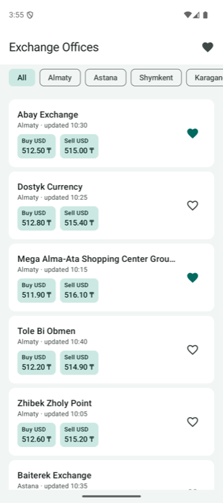
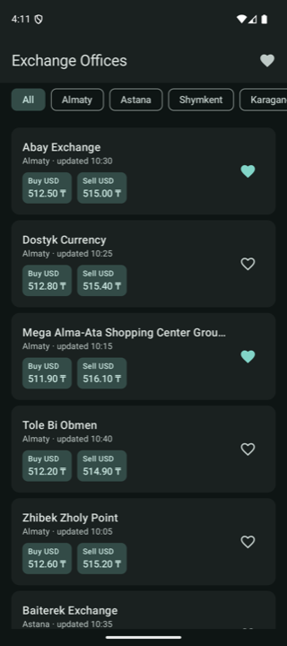
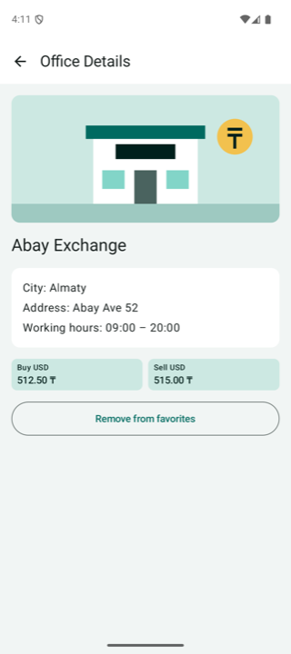
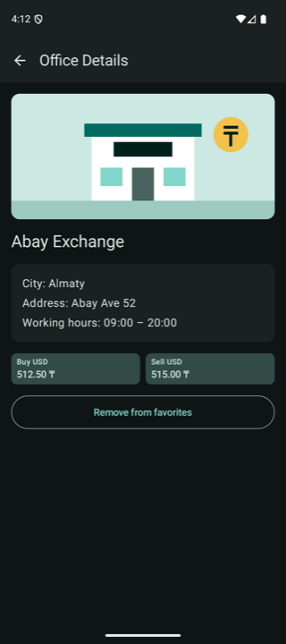
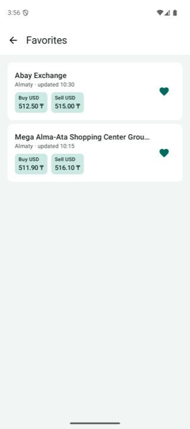
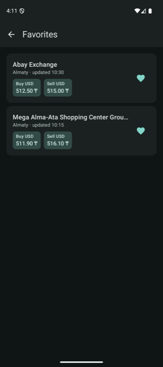
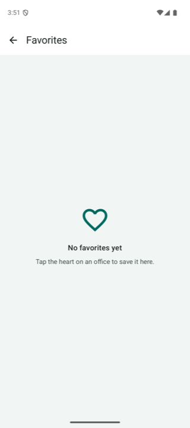
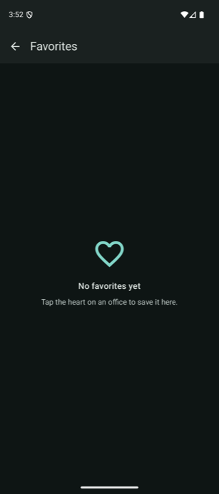
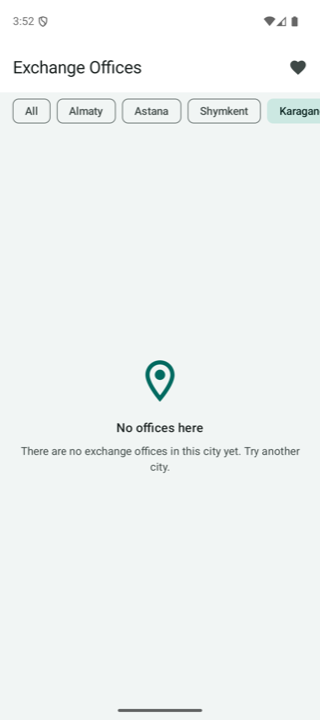
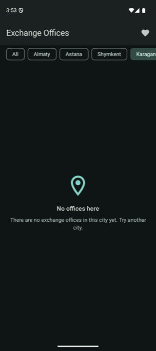

# RateRadar KZ

RateRadar KZ is an Android application concept for tracking currency rates and comparing buy and sell offers from exchange offices in Kazakhstan. This repository contains the course work: the project idea (SIS1), Kotlin problems (SIS2) and the app screens built with Jetpack Compose (SIS3).

## Planned functionality (SIS1)

- Users can choose a base and target currency from supported ISO currency codes.
- Users can enter an amount and calculate its converted value using the latest available rate.
- Users can browse exchange-office offers with buy rates, sell rates, and update times.
- Users can compare and sort offers by the best rate or resulting transaction amount.
- Users can filter offers by city, currency, and transaction type (buy or sell).
- Users can open an exchange-office detail screen with its address, contacts, and working hours.
- Users can add or remove favorite currencies and exchange offices, with selections retained after restart.
- Users can refresh data and see clear loading, empty, offline/cached, and error states.

## SIS3 — App screens in Jetpack Compose

A demo version of RateRadar KZ with three screens. All data is local demo data
(12 exchange offices written in `SampleData.kt`), there is no internet or database.

### Screens

1. **Exchange Offices** (start screen) — list of 12 offices in a `LazyColumn`,
   city filter chips in a `LazyRow`, a heart button on every card to add the office to favorites.
2. **Office Details** — opened by tapping a card. Shows an image, name, city, address,
   working hours, buy/sell rates and a button to add/remove the office from favorites.
3. **Favorites** — opened with the heart in the top bar. Shows only favorite offices,
   or a friendly empty state when there are none.

### Screenshots

| Screen | Light | Dark |
|---|---|---|
| Exchange Offices |  |  |
| Office Details |  |  |
| Favorites |  |  |
| Favorites (empty) |  |  |
| Filter with no results |  |  |

### Sketch vs. app

The labeled sketches are in [design/](design/README.md). The app follows them, with a few small changes:

- The favorite button is a **heart** instead of a star, because `Favorite` / `FavoriteBorder`
  icons are already in the core icon set (no extra library needed).
- A fifth city chip, **Karaganda**, was added. It has no offices, so it shows the
  "No offices here" empty state.
- On the details screen the button changes to an outlined **"Remove from favorites"**
  button when the office is already a favorite.

### How the code is organized

```text
app/src/main/java/kz/edu/kbtu/rateradar/
├── MainActivity.kt                 # entry point, sets the theme and the nav graph
├── model/ExchangeOffice.kt         # data class
├── data/SampleData.kt              # list of 12 offices and the list of cities
├── navigation/RateRadarNavGraph.kt # NavHost, routes, favorites state
└── ui/
    ├── components/                 # reusable composables
    │   ├── OfficeCard.kt           # used on Exchange Offices and Favorites
    │   ├── RateBlock.kt            # used in OfficeCard and on Office Details
    │   └── EmptyState.kt           # used on Favorites, the filter result and Details (not found)
    ├── screens/
    │   ├── ExchangeOfficeListScreen.kt
    │   ├── OfficeDetailsScreen.kt
    │   └── FavoritesScreen.kt
    └── theme/
        ├── Color.kt                # the only place with color values
        ├── Theme.kt                # light and dark color schemes
        ├── Type.kt                 # typography
        └── Dimens.kt               # Spacing (4, 8, 16, 24 dp) and fixed sizes
```

### SIS3 requirements

- 3 screens, each with `Scaffold` + `TopAppBar`; Details and Favorites have a back button.
- `LazyColumn` with 12 items, `LazyRow` with city `FilterChip`s.
- Long office names are cut with `maxLines = 1` and `TextOverflow.Ellipsis`.
- Empty states: no favorites, no offices in the selected city, office not found.
- `Image` from `res/drawable/exchange_placeholder.xml` with a `contentDescription`.
- Custom light and dark color schemes; screens only use `MaterialTheme.colorScheme`
  and `MaterialTheme.typography`; all texts are in `strings.xml`.
- Spacing only from the `Spacing` object; icon buttons are 48 dp, the details button has `heightIn(min = 48.dp)`.
- 3 reusable components, each used in more than one place, with `@Preview`s (light and dark).
  Every screen has a light and a dark preview.
- Navigation Compose: `details/{officeId}` route with an `Int` argument; the details screen finds the office by this id.
- State: `remember { mutableStateOf(setOf<Int>()) }` for favorites and
  `rememberSaveable { mutableStateOf(...) }` for the selected city.

Technologies: Kotlin, Jetpack Compose, Material 3, Navigation Compose.

AI usage is described in [AI_USAGE.md](AI_USAGE.md).

## Project structure

```text
RateRadarKZ/
├── app/
│   ├── src/main/
│   │   ├── java/kz/edu/kbtu/rateradar/
│   │   │   ├── MainActivity.kt
│   │   │   ├── model/ data/ navigation/
│   │   │   └── ui/components/ ui/screens/ ui/theme/
│   │   ├── res/
│   │   └── AndroidManifest.xml
│   ├── src/test/
│   └── build.gradle.kts
├── design/                    # SIS3: labeled screen sketches
├── screenshots/               # SIS3: light and dark screenshots
├── docs/
│   └── SIS1_Project_Description.md
├── output/pdf/
│   └── RateRadar_KZ_SIS1.pdf
├── sis2/                      # SIS2: LeetCode problems in Kotlin
│   ├── 01_TwoSum.kt
│   ├── 14_LongestCommonPrefix.kt
│   ├── 20_ValidParentheses.kt
│   ├── 21_MergeTwoSortedLists.kt
│   ├── 242_ValidAnagram.kt
│   └── README.md
├── gradle/wrapper/
├── .gitignore
├── build.gradle.kts
├── gradle.properties
├── settings.gradle.kts
├── gradlew
└── gradlew.bat
```

## Build and run

1. Open this folder in Android Studio.
2. Let Gradle finish syncing and select an emulator or connected Android device.
3. Click **Run app**.

From the terminal, use:

```bash
./gradlew assembleDebug
```

The project uses JDK 17 bytecode, Android SDK 36, and requires Android 7.0 (API 24) or newer.

## Documentation

The SIS1 project idea, navigation flow chart, and functionality list are in [docs/SIS1_Project_Description.md](docs/SIS1_Project_Description.md).

## SIS2 — Kotlin problems

Five Easy LeetCode problems solved in idiomatic Kotlin, one file per problem, with a short description of each approach: [sis2/](sis2/README.md).
