# RateRadar KZ

An Android app for browsing exchange offices in Kazakhstan and comparing their demo USD buy/sell rates. SIS4 refactors the three SIS3 screens to MVVM with StateFlow. Data is local; there is no live currency API or database.

## Screens

- **Exchange Offices:** twelve offices, search by name/city/address, city chips and favorite hearts.
- **Office Details:** image, address, working hours and rates, with an add/remove favorite button.
- **Favorites:** the saved offices or an empty message. Search and city selection on the main screen do not hide favorites here.

All three screens support loading, content, empty and error states. Every screen has four state previews, plus a dark content preview. The existing light/dark theme, spacing and reusable cards are kept.

## Architecture - SIS4

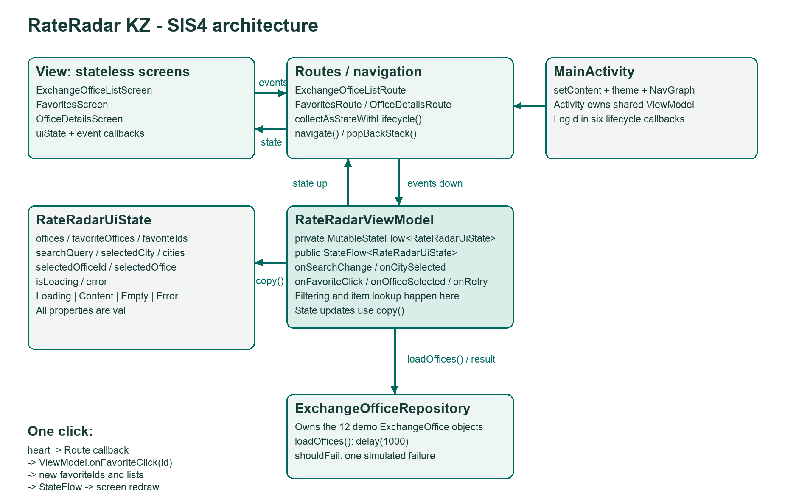

The [plan](design/SIS4_Architecture.md) was committed before the refactor. It lists the UiState fields, events and responsibilities.

- `ExchangeOfficeRepository` owns the records and cities. `loadOffices()` uses `delay(1000)` and can simulate one failed request.
- `RateRadarViewModel` owns the search, city, favorite IDs, selected office and loading/error status. It filters and finds records and updates the private `MutableStateFlow` with `copy()`. Screens get a public read-only `StateFlow`.
- The ViewModel is created above `NavHost`, so its owner is the Activity and all three destinations share it.
- `ExchangeOfficeListRoute`, `OfficeDetailsRoute` and `FavoritesRoute` collect state with `collectAsStateWithLifecycle()` and connect event callbacks.
- Screen functions take `RateRadarUiState` and lambdas. They do not receive a ViewModel, load records or filter the source list.

The handled events are `onSearchChange`, `onCitySelected`, `onFavoriteClick`, `onOfficeSelected` and `onRetry`. Important state stays in the ViewModel; `rememberScrollState` in Details only controls scrolling.

### Trace one click

A heart in `OfficeCard` calls `onFavoriteClick(office.id)`. The callback in `ExchangeOfficeListRoute` calls `RateRadarViewModel.onFavoriteClick`. The ViewModel toggles the ID and calls `updatedState`, which computes the favorite records and updates `RateRadarUiState` with `copy()`. The Route receives the new StateFlow value, and the list heart, details button and Favorites screen display the same selection.

Tapping a card also calls `onOfficeSelected(id)`, then `RateRadarNavGraph` navigates to `details/id`. `OfficeDetailsRoute` forwards the navigation argument to the ViewModel; the screen receives the resolved record. Back uses `popBackStack()`.

### Rotation proof

The following is actual Logcat output from the emulator, after entering `Baiterek`, choosing `Astana`, marking the office as a favorite and rotating to landscape:

```text
--------- beginning of main
D/RateRadarActivity( 7481): onCreate instance=140053151
D/RateRadarActivity( 7481): onStart instance=140053151
D/RateRadarActivity( 7481): onResume instance=140053151
D/RateRadarViewModel( 7481): init instance=96018520
D/RateRadarActivity( 7481): onPause instance=140053151
D/RateRadarActivity( 7481): onStop instance=140053151
D/RateRadarActivity( 7481): onDestroy instance=140053151
D/RateRadarActivity( 7481): onCreate instance=229300425
D/RateRadarActivity( 7481): onStart instance=229300425
D/RateRadarActivity( 7481): onResume instance=229300425
```

Android created a new Activity for the changed configuration, which is visible in the different instance numbers. The ViewModel was created once and was retained by the Activity's ViewModelStore during this change. The new screen collected its existing state, so the search text, selected city and favorite heart stayed the same. A fresh app process creates a new ViewModel; this refactor does not add permanent storage.

The details destination was rotated separately and kept the same office and favorite status. `MainActivity` logs all six lifecycle callbacks; `RateRadarViewModel` logs `init` and `onCleared`.

### State screenshots

| Main screen state | Screenshot |
|---|---|
| Loading | 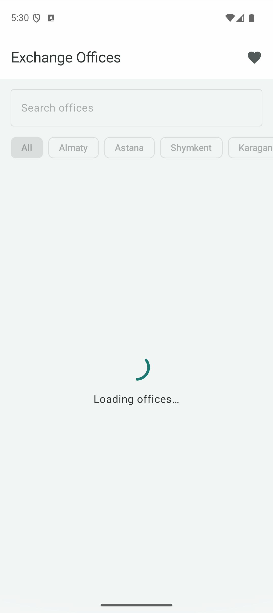 |
| Content | 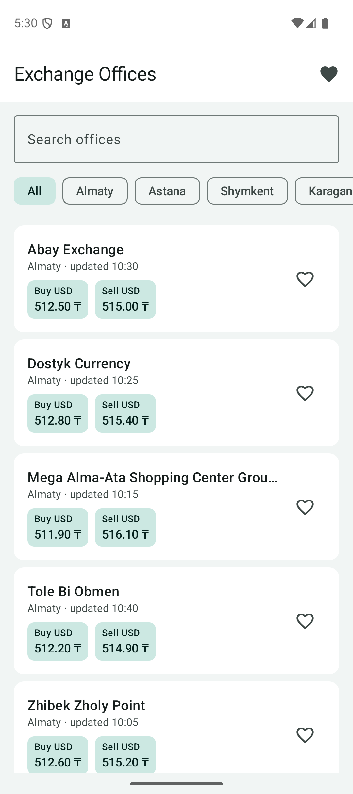 |
| Empty | 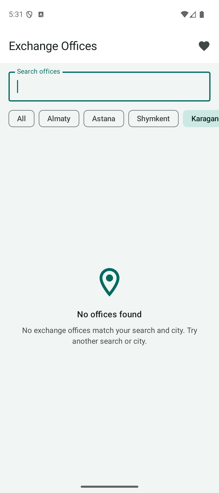 |
| Error | 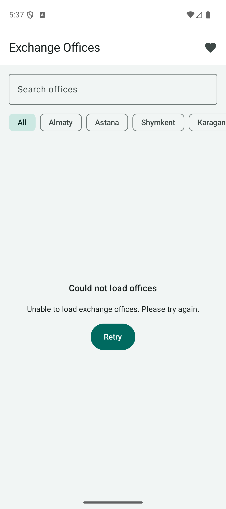 |

| Other checks | Screenshot |
|---|---|
| Rotation keeps search, city and favorite | 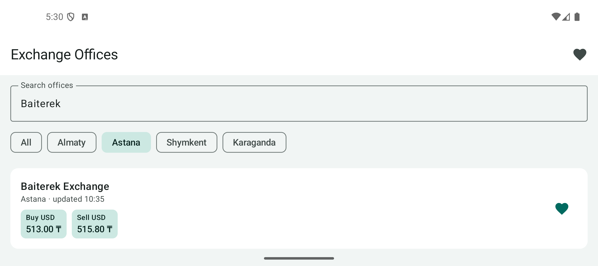 |
| Details | 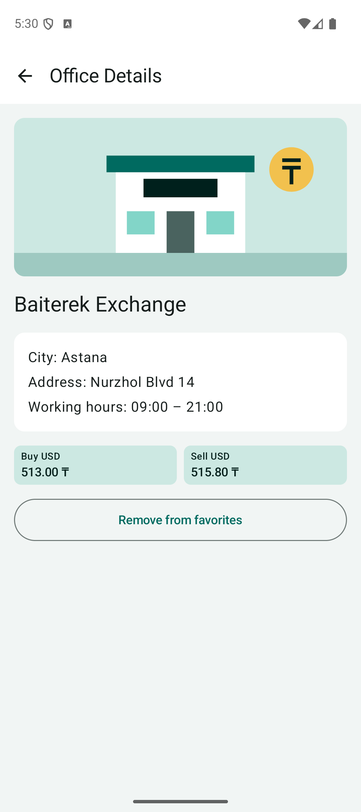 |
| Favorites | 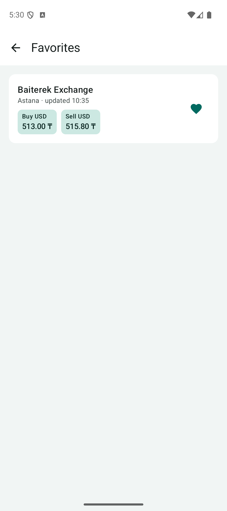 |
| List, dark | 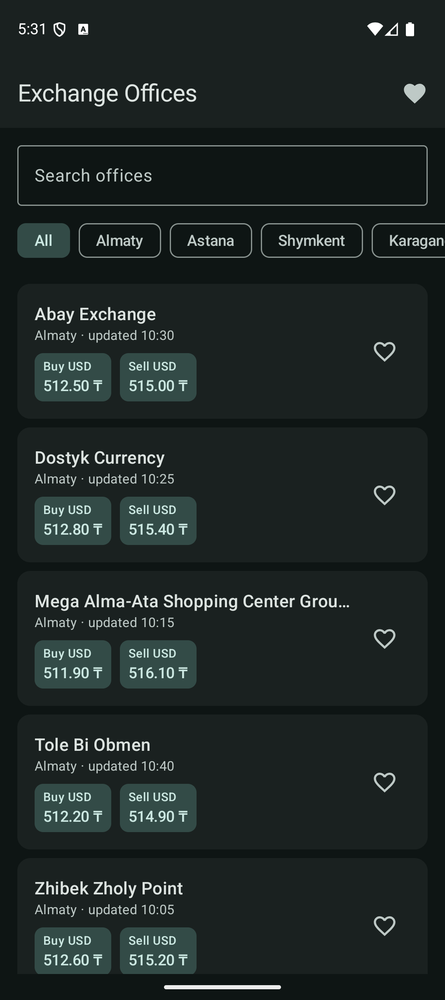 |
| Details, dark | 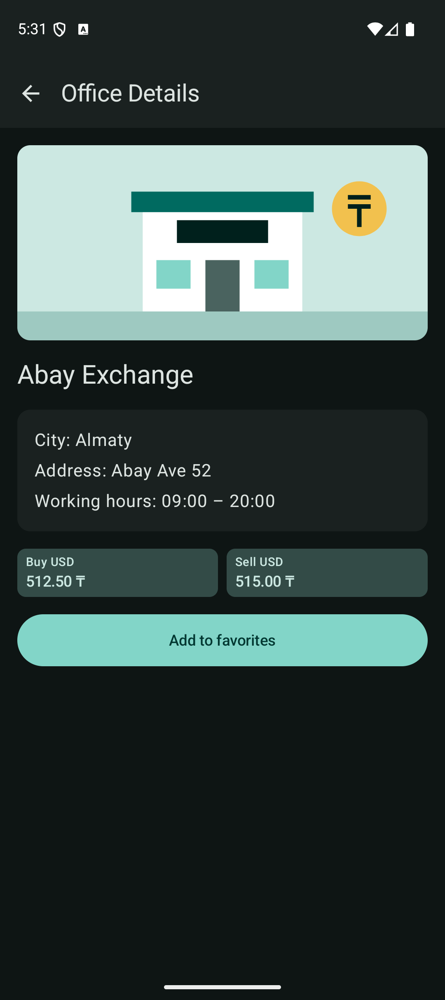 |
| Favorites, dark | 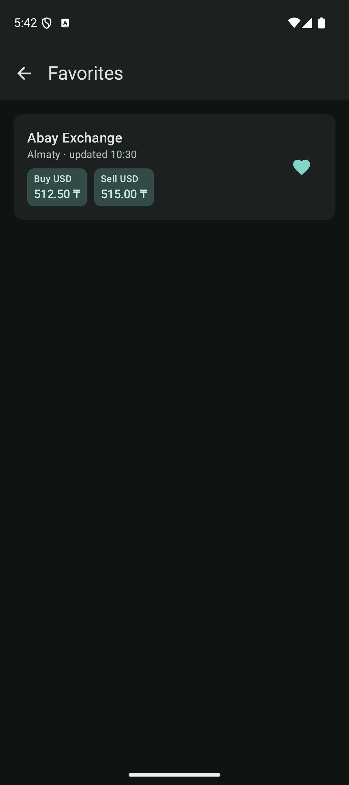 |

## Build and run

Open this folder in Android Studio, let Gradle sync, select an emulator and run `app`.

The project compiles with Android SDK 36, targets API 36 and supports API 24+. Use the Android Studio bundled JDK or another compatible JDK; project bytecode targets Java 17.

```bash
./gradlew assembleDebug
./gradlew testDebugUnitTest lintDebug
```

### Demonstrate error and Retry

Build and install a version with a simulated initial failure:

```bash
./gradlew installDebug -PsimulateLoadError=true
```

Open the app in a fresh process. The repository waits, then shows an error with a Retry button. The flag causes one failure per repository instance, so Retry waits again and succeeds. Query and city changes made before Retry are retained.

For the normal version:

```bash
./gradlew installDebug
```

The flag defaults to false. To repeat the failure demonstration, force-stop and reopen the error-enabled build. The flag is a build setting, not a new user-facing feature.

## Checks

Coroutine tests cover the delayed repository, content after loading, combined search/city filtering, empty results, shared favorites and details, invalid IDs, error recovery and preserving state across reloads. The existing arithmetic test is also kept. Emulator checks cover rotation, navigation/back, favorites removal, empty results, dark theme and a simulated failure with Retry.

## Project structure

```text
app/src/main/java/kz/edu/kbtu/rateradar/
├── MainActivity.kt
├── model/ExchangeOffice.kt
├── data/ExchangeOfficeRepository.kt
├── viewmodel/
│   ├── RateRadarUiState.kt
│   └── RateRadarViewModel.kt
├── navigation/
│   ├── RateRadarNavGraph.kt
│   └── RateRadarRoutes.kt
└── ui/
    ├── screens/       # uiState and event callbacks
    ├── components/    # cards, rates, empty/loading/error displays
    ├── preview/       # fake data only for previews
    └── theme/         # colors, typography and shared dimensions
```

`design/` contains the SIS3 screen sketches and SIS4 architecture plan. `screenshots/` contains emulator captures. SIS1 idea and planned functionality are in [docs/SIS1_Project_Description.md](docs/SIS1_Project_Description.md); SIS2 Kotlin tasks are in [sis2/](sis2/README.md).

## Sketch to app

The original screen sketches remain in [design/](design/README.md). SIS3 changed the sketch's star into a heart, added an empty Karaganda filter and used an outlined remove-favorite button on Details. SIS4 adds a search field and loading/error content inside the same screen scaffolds. Favorites uses `EmptyState` with a centered Column rather than the Box shown in its original sketch.

AI assistance is documented in [AI_USAGE.md](AI_USAGE.md).
