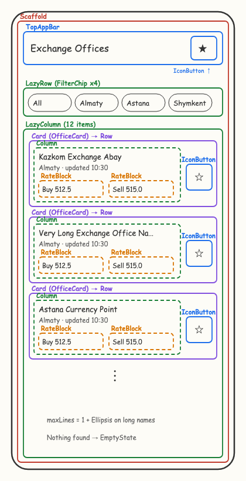
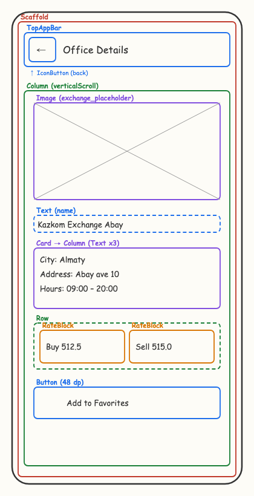
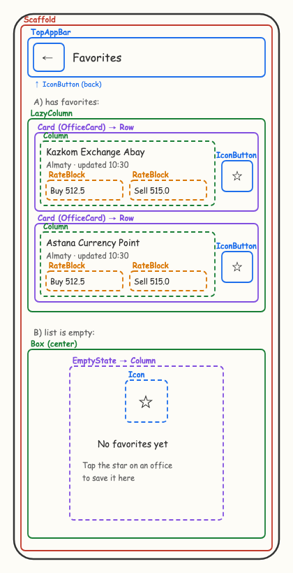

# Design sketches

Wireframes of every screen, drawn before writing any screen code.
Each box is labeled with the Compose element that will build it.

| Screen | Sketch |
|---|---|
| Exchange Offices (list, start screen) |  |
| Office Details |  |
| Favorites (with items / empty) |  |

Color legend: red = Scaffold, blue = TopAppBar / buttons / text,
green = layout containers (Column, Row, LazyColumn, LazyRow, Box),
purple = Card / Image, orange = RateBlock component.
