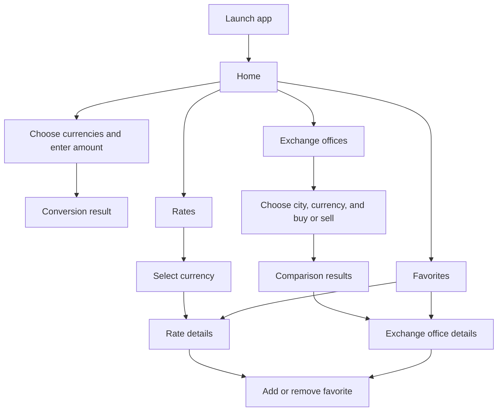

# Android Development — SIS1: Project Description

## RateRadar KZ

**Student:** Alisher Mutaliyev  
**Repository:** <https://github.com/xlmtvv/rateradar-kz>

## 1. Project idea

RateRadar KZ is an Android application that helps users track the latest available currency rates and compare buy and sell offers from exchange offices in Kazakhstan. People currently spend time checking several sources and can lose money when they rely on outdated or unfavorable rates, so this is a practical, recurring problem. Users can select a currency pair, enter an amount, compare the resulting offers, and save preferred currencies or exchange offices. The app is designed for travelers, students, freelancers, small-business owners, and anyone who regularly exchanges currency.

## 2. Flow chart

## 3. Functionality list

- Users can choose a base and target currency from supported ISO currency codes.
- Users can enter an amount and calculate its converted value using the latest available rate.
- Users can browse exchange-office offers with buy rates, sell rates, and update times.
- Users can compare and sort offers by the best rate or resulting transaction amount.
- Users can filter offers by city, currency, and transaction type (buy or sell).
- Users can open an exchange-office detail screen with its address, contacts, and working hours.
- Users can add or remove favorite currencies and exchange offices, with selections retained after restart.
- Users can refresh data and see clear loading, empty, offline/cached, and error states.

## 4. Project setup and repository

The initial Android Studio project is implemented in Kotlin as a single-activity application. It includes the Gradle wrapper, an Android-compatible `.gitignore`, a runnable `app` module, and root-level build and run documentation. The public repository is available at <https://github.com/xlmtvv/rateradar-kz>.

## 5. Deliverables checklist

- [x] Project idea paragraph (four sentences)
- [x] Core screen and navigation flow chart
- [x] Eight concrete, testable functionality items
- [x] Kotlin Android Studio project scaffold
- [x] Android `.gitignore`
- [x] Local Git repository and initial scaffold commit
- [x] Public GitHub repository and initial push
- [x] Root `README.md` with the current structure and build/run instructions
